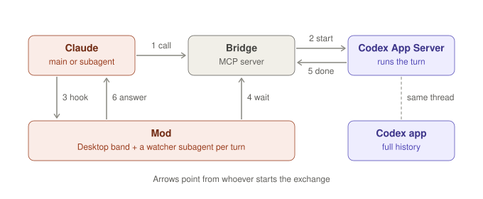

# agent-relay

<p align="center">
  
  
</p>

A Claude Code plugin that lets Claude launch OpenAI Codex subagents on any model and effort.

- Each run is a real Codex thread, so its history opens in the Codex app or in Claude Desktop.
- Claude Desktop shows each subagent's state while it runs: a band above the prompt, the status line, a running task.
- When a turn ends, Codex's final answer is messaged back to whichever Claude dispatched it.



## Install

Requires `uv`, Python ≥ 3.11 (uv fetches it), and `codex` ≥ 0.166 with its app-server daemon running. The Codex app runs it, or start it with `codex app-server daemon start`.

```bash
claude plugin marketplace add garrettf/agent-relay
```

```bash
claude plugin install codex-relay@agent-relay --scope user
```

Then start a new session. Or, from a Claude Code prompt: `/plugin marketplace add garrettf/agent-relay`, then `/plugin install codex-relay@agent-relay`.

## How it works

`claude-plugin/` is one Claude Code plugin, `codex-relay`, with two parts:

- **`codex-thread-bridge/`** is the MCP server that does the Codex work. It's a vendored fork of [saidelike/codex-thread-bridge](https://github.com/saidelike/codex-thread-bridge) at `4b58215` (MIT).
  - It drives the shared Codex App Server daemon (`$CODEX_HOME/app-server-control/app-server-control.sock`). Its threads open in the Codex app by deeplink but stay out of its thread list: the prompt is sent as a tool output, not a user message.
  - Its tools are `create_thread`, `send_message_to_thread`, `steer_thread`, `wait_thread`, `read_thread*`, `list_threads`, ….
  - **Fork changes:**
    - Waits are pushed by App Server's `turn/completed` instead of polling `thread/turns/list` (`turns.py`).
    - Model family names resolve to the newest listed model: `luna` → `gpt-6-luna`.
    - With `--events-socket`, a Unix-socket HTTP endpoint `GET /wait?turns=<thread>:<turn>,…` holds a request open until a turn ends (`events.py`). Each dispatching tool's result names that socket as `eventsSocket`.
- **`hooks/register.tsx`** is the mod: UI and delivery.
  - A band above the prompt lists each running Codex turn (model, effort, title, elapsed time) and the last 5 finished ones, each with an **Open in Codex** button (runs `open codex://threads/<id>`). The status line shows the running ones.
  - Each dispatched turn gets a watcher subagent, which shows as a running task. Its wait is a `$.http.fetch` the bridge's events socket holds open, re-armed every 25s (the fetch's 30s cap). When the turn ends, it `SendMessage`s the dispatcher (main, or the subagent that dispatched it) Codex's final answer, which wakes an idle main.
  - A prompt that names a Codex model ("kick off a luna medium subagent …") carries a note that routes it to `create_thread`, not the Agent tool.

**Why a watcher agent:** a real agent's SendMessage is the only way a mod can start a turn on an idle main conversation without writing a user-role row. MCP channels would do this natively, but Claude Desktop runs sessions in SDK mode, where channels are off.
